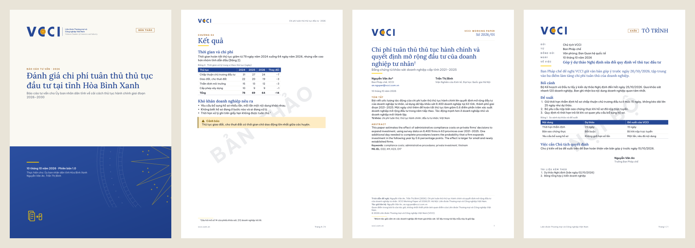

# quarto-vcci: mẫu tài liệu VCCI cho Quarto

Bộ mẫu này giúp viết báo cáo, working paper và tờ trình theo bộ nhận diện thương hiệu của Liên đoàn Thương mại và Công nghiệp Việt Nam (VCCI). Bạn soạn nội dung bằng văn bản thường (Markdown), chạy một lệnh và nhận về hai file:

- **PDF khổ A4**, trình bày theo đúng bộ nhận diện (bìa, màu, font, logo), để gửi đi và in;
- **Word (.docx)** dùng các style của VCCI, để đồng nghiệp sửa tiếp.

> **Lưu ý:** đây không phải bộ mẫu chính thức của VCCI. Bộ mẫu được làm phi thương mại, để phục vụ công việc. Xem mục [Lưu ý](#lưu-ý).

*English: Quarto templates for VCCI (Vietnam Chamber of Commerce and Industry) reports, working papers and memos, rendered to an A4 PDF (Typst) and Word. Every format also supports English (`lang: en`). Install with `quarto use template trongtrd/quarto-vcci`. Unofficial: a non-commercial project by Truong Duc Trong for work use, not an official VCCI product.*



| Loại tài liệu | Dùng khi | Bản mẫu |
|---|---|---|
| **Báo cáo** (`vcci-report`) | Báo cáo tư vấn, báo cáo nghiên cứu: có bìa, mục lục, chương, bìa sau | [PDF](examples/report.pdf) · [Word](https://github.com/trongtrd/quarto-vcci/releases/download/v1.0.0/report.docx) |
| **Working paper** (`vcci-wp`) | Bài nghiên cứu: số hiệu, tóm tắt song ngữ, mã JEL, trích dẫn APA | [PDF](examples/wp.pdf) · [tiếng Anh](examples/wp-en.pdf) · [Word](https://github.com/trongtrd/quarto-vcci/releases/download/v1.0.0/wp.docx) |
| **Tờ trình** (`vcci-memo`) | Văn bản đệ trình nội bộ 1–2 trang: Gửi, Từ, Về việc, chữ ký | [PDF](examples/memo.pdf) · [tiếng Anh](examples/memo-en.pdf) · [Word](https://github.com/trongtrd/quarto-vcci/releases/download/v1.0.0/memo.docx) |
| **Biểu đồ** | Theme cho matplotlib (Python), ggplot2 (R), Stata | [PDF](examples/charts.pdf) |

## Mục lục

1. [Cần chuẩn bị](#1-cần-chuẩn-bị)
2. [Bắt đầu trong 5 phút](#2-bắt-đầu-trong-5-phút)
3. [Viết nội dung](#3-viết-nội-dung)
4. [Báo cáo](#4-báo-cáo-vcci-report)
5. [Working paper](#5-working-paper-vcci-wp)
6. [Tờ trình](#6-tờ-trình-vcci-memo)
7. [Trích dẫn và tài liệu tham khảo](#7-trích-dẫn-và-tài-liệu-tham-khảo)
8. [Biểu đồ: Python, R, Stata](#8-biểu-đồ-python-r-stata)
9. [Bản Word](#9-bản-word)
10. [Cập nhật, dùng trong dự án có sẵn](#10-cập-nhật-dùng-trong-dự-án-có-sẵn)
11. [Gặp lỗi?](#11-gặp-lỗi)

Cuối trang: [Người thực hiện và cách trích dẫn](#người-thực-hiện-và-cách-trích-dẫn), [Lưu ý](#lưu-ý), [Giấy phép](#giấy-phép).

## 1. Cần chuẩn bị

**Bắt buộc: Quarto** (miễn phí, có bản cho Windows, macOS và Linux).

1. Tải và cài từ [quarto.org/docs/get-started](https://quarto.org/docs/get-started/). Cần bản 1.6 trở lên; bộ mẫu đã được thử với Quarto 1.9.
2. Mở một cửa sổ dòng lệnh **mới** (xem cách mở ở bước 2) và gõ:
   ```bash
   quarto --version
   ```
   Thấy số phiên bản (ví dụ `1.9.38`) là được.

Không cần cài font, LaTeX hay Microsoft Word: bộ mẫu đã kèm font Lora, Be Vietnam Pro và JetBrains Mono, còn Quarto có sẵn Typst để tạo PDF.

**Nên có: một trình soạn thảo** để sửa file `.qmd` và bấm nút xuất tài liệu: [Positron](https://positron.posit.co/), [RStudio](https://posit.co/download/rstudio-desktop/) hoặc [VS Code](https://code.visualstudio.com/) có extension Quarto. Dùng Notepad cũng được, khi đó bạn xuất tài liệu bằng lệnh.

**Chỉ cần khi vẽ biểu đồ bằng mã** ngay trong tài liệu: R hoặc Python (mục 8). Không vẽ biểu đồ thì bỏ qua phần này.

## 2. Bắt đầu trong 5 phút

### Bước 1. Mở cửa sổ dòng lệnh ở thư mục bạn muốn

- **Windows 11:** mở thư mục (chẳng hạn `Documents`) trong File Explorer, nhấp chuột phải vào chỗ trống rồi chọn **Open in Terminal**.
- **macOS:** mở ứng dụng Terminal, gõ `cd ` (có dấu cách), kéo thư mục vào cửa sổ rồi nhấn Enter.
- **Trong Positron, RStudio, VS Code:** dùng thẻ Terminal của trình soạn thảo.

### Bước 2. Tạo dự án từ mẫu

```bash
quarto use template trongtrd/quarto-vcci
```

Quarto sẽ hỏi bốn câu:

| Câu hỏi | Trả lời |
|---|---|
| `Do you trust the authors of this template?` | Nhấn **Y** rồi Enter |
| `Create a subdirectory for template?` | Nhấn **Y** rồi Enter (tạo thư mục mới cho dự án) |
| `Directory name:` | Gõ tên thư mục, không dấu, không cách, ví dụ `bao-cao-pci`, rồi Enter |
| `Would you like to continue?` (sau danh sách VCCI Memo, VCCI Report, VCCI Working Paper) | Nhấn **Y** rồi Enter |

Quarto tải bộ mẫu từ GitHub và tạo thư mục `bao-cao-pci` gồm:

| File | Nội dung |
|---|---|
| `bao-cao-pci.qmd` | **Báo cáo mẫu**, đặt tên theo thư mục |
| `wp.qmd`, `references.bib` | Working paper mẫu và file tài liệu tham khảo đi kèm |
| `memo.qmd` | Tờ trình mẫu |
| `charts.qmd` | Báo cáo mẫu có biểu đồ vẽ bằng R |
| `charts/` | Theme biểu đồ cho Python, R, Stata |
| `_extensions/` | Bộ mẫu (định dạng, font, logo). **Không sửa, không xóa.** |

Mẫu nào không dùng thì xóa file `.qmd` của mẫu đó, nhưng giữ nguyên `_extensions/`.

### Bước 3. Xuất thử

```bash
cd bao-cao-pci
quarto render bao-cao-pci.qmd
```

Khoảng 10 giây sau, bên cạnh file `.qmd` sẽ có **`bao-cao-pci.pdf`** và **`bao-cao-pci.docx`**. Mở file PDF ra xem: kết quả giống [bản mẫu](examples/report.pdf).

Trong Positron, RStudio, VS Code: mở file `.qmd` rồi bấm **Render** (hoặc Ctrl+Shift+K; trên macOS ⌘+Shift+K).

### Bước 4. Viết báo cáo của bạn

Mở `bao-cao-pci.qmd` bằng trình soạn thảo. File có hai phần:

1. **Phần thông tin**, nằm giữa hai dòng `---` ở đầu file: tiêu đề, tác giả, ngày, bên đặt hàng… Chỉ sửa phần sau dấu hai chấm; giữ nguyên tên khóa và khoảng thụt đầu dòng. Ý nghĩa từng khóa xem ở mục 4.
2. **Phần nội dung** ở bên dưới: thay chữ mẫu bằng nội dung của bạn (cách viết xem ở mục 3).

Lưu file, xuất lại (bước 3), xem PDF. Cứ thế cho đến khi xong.

### Bước 5. Chỉ xuất PDF hoặc chỉ xuất Word

Mặc định, mỗi lần xuất sẽ ra cả hai file. Muốn nhanh hơn thì chỉ xuất một loại:

```bash
quarto render bao-cao-pci.qmd --to vcci-report-typst
quarto render bao-cao-pci.qmd --to vcci-report-docx
```

Lệnh thứ nhất chỉ xuất PDF, lệnh thứ hai chỉ xuất Word. Với working paper và tờ trình, thay `vcci-report` bằng `vcci-wp` hoặc `vcci-memo`.

## 3. Viết nội dung

Nội dung viết bằng Markdown, tức là văn bản thường cộng thêm vài ký hiệu để đánh dấu tiêu đề, chữ đậm, danh sách, bảng…

| Muốn có | Cách viết |
|---|---|
| Chương (mỗi chương sang trang mới, nhãn "CHƯƠNG 01") | `# Kết quả` |
| Mục, mục con | `## Chi phí thời gian`, `### Theo ngành` |
| Chương không đánh số (Tóm tắt, Phụ lục) | `# Tóm tắt {.unnumbered}` |
| Chữ đậm, chữ nghiêng | `**đậm**`, `*nghiêng*` |
| Danh sách | Mỗi dòng bắt đầu bằng `- ` (hoặc `1. ` cho danh sách đánh số) |
| Chú thích cuối trang | `Câu văn.^[Nội dung chú thích.]` |
| Liên kết | `[VCCI](https://vcci.com.vn)` |
| Hình, có chú thích | `` |
| Trích dẫn tài liệu | `[@vcci2025]` (mục 7) |

**Bảng:**

```markdown
| Thủ tục          | 2024 | 2025 |
|------------------|-----:|-----:|
| Chấp thuận đầu tư |   21 |   18 |
| Giao đất         |   32 |   30 |

: Số ngày trung bình theo thủ tục {#tbl-thutuc}
```

Dòng bắt đầu bằng `:` là tiêu đề bảng. Nhờ nhãn `{#tbl-thutuc}`, trong bài có thể viết "xem @tbl-thutuc" và Quarto sẽ in ra "Bảng 1". `--:` căn phải cột số. Cột nào có chữ dài thì cho nhiều dấu `-` hơn ở dòng thứ hai, vì độ rộng cột được chia theo số dấu `-`.

**Khối riêng của VCCI:**

```markdown
::: lead
Hai, ba câu nêu thông điệp chính, in to màu xanh ở đầu chương.
:::

::: figures
64 ngày | Thời gian hoàn tất thủ tục
38% | Doanh nghiệp đi lại từ ba lần trở lên
:::

::: {.highlight title="Ba khuyến nghị ưu tiên"}
Hộp nhấn mạnh nền xanh nhạt, gạch xanh bên trái.
:::

::: label
Nhãn chữ in hoa nhỏ
:::
```

Khối `figures` tạo các thẻ số liệu, mỗi dòng viết theo dạng `số | mô tả`. Các hộp ghi chú của Quarto (`::: callout-note`, `-tip`, `-warning`, `-important`, `-caution`) tự lấy màu trạng thái của VCCI.

Phương trình viết theo cú pháp LaTeX: `$y = a + bx$` cho phương trình nằm trong câu, `$$ ... $$ {#eq-ten}` cho phương trình đứng riêng một dòng và có đánh số. Mã nguồn đặt giữa hai dòng ```` ``` ````.

Hướng dẫn Markdown đầy đủ của Quarto: [quarto.org/docs/authoring/markdown-basics](https://quarto.org/docs/authoring/markdown-basics.html).

## 4. Báo cáo (`vcci-report`)

Bắt đầu từ file báo cáo mẫu (`<tên-thư-mục>.qmd`). Phần đầu file trông như sau:

```yaml
---
title: "Đánh giá chi phí tuân thủ thủ tục đầu tư"
subtitle: "Báo cáo tư vấn cho Ủy ban nhân dân tỉnh"
report-label: "Báo cáo tư vấn"
client: "Ủy ban nhân dân tỉnh Hòa Bình Xanh"
author:
  - name: Nguyễn Văn An
    affiliations:
      - name: Ban Pháp chế, VCCI
date: 2026-10-10
status: "Bản thảo"       # xóa dòng này khi phát hành
hero: 4                  # hình minh họa trên bìa, số 1–24
toc: true                # có mục lục
format:
  vcci-report-typst: default
  vcci-report-docx: default
---
```

| Khóa | Ý nghĩa | Hiện ở |
|---|---|---|
| `title`, `subtitle` | Tiêu đề, phụ đề | Bìa, trang thông tin |
| `report-label` | Nhãn trên tiêu đề, mặc định "Báo cáo" (ví dụ "Báo cáo tư vấn") | Bìa |
| `short-title` | Tên rút gọn | Đầu trang |
| `client` | Bên đặt hàng | Bìa, trang thông tin |
| `author` (kèm `affiliations`), `team` | Tác giả; `team` thay danh sách nhóm thực hiện nếu cần | Bìa, trang thông tin |
| `date`, `version` | Ngày (viết `2026-10-10`, in ra "10 tháng 10 năm 2026"), phiên bản | Bìa, trang thông tin |
| `status` | Ví dụ "Bản thảo", "Mật": nhãn trên bìa và dấu chìm mọi trang. Xóa khi phát hành | Bìa, mọi trang |
| `hero` | Hình minh họa trên bìa, số 1–24 | Bìa |
| `citation-text` | Gợi ý trích dẫn báo cáo này | Trang thông tin |
| `disclaimer` | Lưu ý, miễn trừ | Trang thông tin |
| `contact` | Thay địa chỉ liên hệ mặc định của VCCI | Bìa sau |
| `cover: false`, `back-cover: false` | Bỏ bìa trước (cùng trang thông tin) hoặc bìa sau | |
| `toc: true` | Mục lục | Sau trang thông tin |
| `bibliography` | File tài liệu tham khảo (mục 7) | Chú thích, cuối tài liệu |
| `lang: en` | Báo cáo tiếng Anh; thêm `date-format: "D MMMM YYYY"` | |

## 5. Working paper (`vcci-wp`)

Bắt đầu từ `wp.qmd` (kèm `references.bib`). Trang đầu có tên bộ và số hiệu, tiêu đề, tác giả (đơn vị, email), ngày, tóm tắt kèm từ khóa (một hoặc hai ngôn ngữ) và mã JEL. Cuối trang đầu là cách trích dẫn bài, tác giả liên hệ và lời miễn trừ. Các mục trong bài đánh số 1, 1.1; phương trình có đánh số; tài liệu tham khảo theo kiểu APA ở cuối bài.

| Khóa | Ý nghĩa |
|---|---|
| `wp-number` | Số hiệu, ví dụ `"2026/01"`: hiện "VCCI Working Paper số 2026/01" (tiếng Anh: "No. 2026/01") |
| `wp-series` | Tên bộ, mặc định "VCCI Working Paper" |
| `lang` | `vi` (mặc định) hoặc `en`. Bài tiếng Anh nên thêm `date-format: "D MMMM YYYY"` |
| `author` | `name`, `email`, `affiliations`; `attributes: {corresponding: true}` đánh dấu \* tác giả liên hệ |
| `abstract`, `keywords` | Tóm tắt và từ khóa theo ngôn ngữ của bài |
| `abstract-en`, `keywords-en` | Tóm tắt tiếng Anh cho bài tiếng Việt (bài tiếng Anh dùng `abstract-vi`, `keywords-vi`) |
| `jel` | Mã JEL, ví dụ `[D22, K23]` |
| `thanks` | Lời cảm ơn: chú thích † ở tiêu đề |
| `citation-text` | Thay gợi ý trích dẫn tự sinh ("Tác giả (năm). Tiêu đề. VCCI Working Paper số …. Hà Nội: VCCI.") |
| `disclaimer` | Thay lời miễn trừ mặc định |
| `status`, `short-title`, `version`, `toc` | Như báo cáo |

## 6. Tờ trình (`vcci-memo`)

Bắt đầu từ `memo.qmd`. Tờ trình dài 1–2 trang; từ trang 2, đầu trang nhắc lại nội dung "Về việc".

| Khóa | Ý nghĩa |
|---|---|
| `title` | Nội dung "Về việc" |
| `recipient`, `sender`, `copy-to` | Gửi, Từ, Đồng gửi. **Không dùng `to` và `from`** (Quarto dành riêng hai khóa này). Không có `sender` thì lấy `author` |
| `date` | Ngày |
| `priority` | Ví dụ "Khẩn": nhãn cạnh chữ "TỜ TRÌNH" |
| `status` | Ví dụ "Nội bộ", "Mật": dấu chìm mọi trang |
| `signature` | `name` và `title` (chức vụ), đặt bên phải cuối tờ trình |
| `attachments` | Danh sách tài liệu kèm theo |
| `memo-label` | Thay chữ "Tờ trình" (tiếng Anh: "Memo") |
| `lang: en` | Tờ trình tiếng Anh ("MEMO", To, From, Subject…); thêm `date-format: "D MMMM YYYY"` |

## 7. Trích dẫn và tài liệu tham khảo

1. Ghi danh sách tài liệu vào một file `.bib` (xem file mẫu `references.bib`). Zotero, Mendeley và EndNote đều xuất được loại file này.
2. Khai báo file đó ở phần đầu tài liệu: `bibliography: references.bib`.
3. Trong bài, trích dẫn bằng khóa của từng tài liệu.

| Loại tài liệu | Kiểu trích dẫn | Viết |
|---|---|---|
| Báo cáo, tờ trình | Chicago, chú thích cuối trang (lần đầu đầy đủ, các lần sau rút gọn) | Luôn trong ngoặc vuông: `[@vcci2025]`, `[@vcci2025, tr. 12]`. Viết `@vcci2025` không có ngoặc sẽ in cả nguồn vào giữa câu |
| Working paper | APA, tác giả–năm | `[@vcci2025]` cho "(VCCI, 2025)"; `@vcci2025` cho "VCCI (2025)" trong câu |

Khi viết file `.bib`, cần lưu ý:
- **Tên người Việt** đặt trong ngoặc nhọn kép: `author = {{Nguyễn Thị Hạnh} and {Trần Đức Long}}`. Thiếu ngoặc, tên sẽ bị đảo thành "Thị Hạnh Nguyễn" hoặc viết tắt thành "Nguyễn, T. H.".
- **Báo cáo kỹ thuật** (`@techreport`): thêm `type = {Báo cáo kỹ thuật}` để không hiện chữ "technical report".
- Danh mục "Tài liệu tham khảo" tự xuất hiện ở cuối tài liệu (sau phụ lục), nên không cần tự thêm mục này.

## 8. Biểu đồ: Python, R, Stata

Thư mục `charts/` chứa theme biểu đồ theo phần "Dữ liệu và biểu đồ" của hướng dẫn thương hiệu: thứ tự màu các chuỗi số liệu, font, đường lưới, dấu phẩy thập phân. Cách dùng và ví dụ cho từng công cụ: [charts/README.md](charts/README.md).

| Công cụ | Trong tài liệu Quarto | Cần cài |
|---|---|---|
| **R** (ggplot2) | Khối mã đầu tiên: `source("charts/theme_vcci.R", encoding = "UTF-8")` rồi `vcci_setup()`. Mẫu: `charts.qmd` ([kết quả](examples/charts.pdf)) | R, và trong R: `install.packages(c("rmarkdown", "knitr", "ggplot2", "scales", "systemfonts", "svglite", "ragg"))` |
| **Python** (matplotlib) | `import sys; sys.path.insert(0, "charts")`, `import vcci_charts as vcci`, rồi `vcci.use()`. Thêm `fig-format: svg` cho PDF, `fig-format: png` cho Word | Python, và `python -m pip install jupyter matplotlib` |
| **Stata** | Vẽ trong Stata: `adopath + "charts"`, `do charts/vcci_graph.do`, vẽ, `graph export ten.svg`; rồi chèn vào tài liệu `` | Stata 18 trở lên; cài font Lora và Be Vietnam Pro vào máy (file `.ttf` trong `_extensions/…/fonts`) |

Chú thích hình (`fig-cap`) nêu thông điệp chính của biểu đồ. Nguồn số liệu ghi ngay dưới biểu đồ (`caption` trong ggplot, `vcci.source()` trong Python, `note()` trong Stata). Nếu không dùng R, hãy xóa `charts.qmd`, vì file này chỉ xuất được khi máy có R.

## 9. Bản Word

Bản Word dùng các style của VCCI (tiêu đề, bảng VCCI Table, hộp nhấn mạnh) và có nhúng font, để đồng nghiệp sửa nội dung. Bản để phát hành là bản PDF. So với PDF, bản Word khác ở mấy điểm sau:

- Không có bìa màu; trang đầu là tiêu đề, tác giả, ngày.
- **Mục lục trống khi mở lần đầu:** nhấp vào mục lục rồi nhấn F9 (hoặc nhấp chuột phải, chọn Update Field).
- Danh sách đặt trong hộp `::: highlight` sẽ nằm ra ngoài hộp.
- Phương trình dùng font Cambria Math.

## 10. Cập nhật, dùng trong dự án có sẵn

**Cập nhật bộ mẫu lên bản mới** (chạy trong thư mục dự án, trả lời Y khi được hỏi):

```bash
quarto add trongtrd/quarto-vcci
```

Lệnh này chỉ thay thư mục `_extensions/`, không đụng tới các file `.qmd` của bạn. Những gì thay đổi ở mỗi bản được ghi trong [CHANGELOG](https://github.com/trongtrd/quarto-vcci/blob/main/CHANGELOG.md).

**Dùng cố định một phiên bản** (chẳng hạn khi sau này cần xuất lại tài liệu y hệt):

```bash
quarto use template trongtrd/quarto-vcci@v1.0.0
```

**Dùng cho một dự án đã có**, không cần các file mẫu: chạy `quarto add trongtrd/quarto-vcci` trong thư mục dự án, rồi khai báo định dạng ở đầu file `.qmd`:

```yaml
format:
  vcci-report-typst: default     # PDF; working paper: vcci-wp-typst, tờ trình: vcci-memo-typst
  vcci-report-docx: default      # Word
```

## 11. Gặp lỗi?

| Hiện tượng | Cách xử lý |
|---|---|
| `quarto` không được nhận ra ("not recognized", "command not found") | Quarto chưa cài, hoặc cửa sổ dòng lệnh mở trước khi cài. Đóng và mở cửa sổ mới. |
| `Unable to read the extension 'vcci-report'` | File `.qmd` không nằm cùng thư mục với `_extensions/`. Chuyển file vào thư mục dự án, hoặc chạy `quarto add trongtrd/quarto-vcci` ở thư mục của file. |
| `quarto use template` báo thư mục không trống | Trả lời **Y** khi được hỏi tạo thư mục con, hoặc chạy lệnh trong một thư mục trống. |
| Báo lỗi khi ghi file PDF hay Word | File đang mở trong Acrobat hay Word. Đóng file rồi xuất lại. |
| `charts.qmd` báo lỗi về R hay thiếu gói (`there is no package called …`) | Cài R và các gói ở mục 8, hoặc xóa `charts.qmd` nếu không cần. |
| Tờ trình báo `cannot produce pdf output from …` | Đang dùng khóa `to` hay `from`; đổi thành `recipient`, `sender`. |
| Tên tác giả Việt bị đảo hay viết tắt trong tài liệu tham khảo | Đặt tên trong ngoặc nhọn kép trong file `.bib` (mục 7). |
| Nguồn tài liệu bị in vào giữa câu (báo cáo, tờ trình) | Viết trích dẫn trong ngoặc vuông: `[@khoa]`. |
| Mục lục bản Word trống | Nhấp vào mục lục, nhấn F9. |
| Bảng rộng bị chia cột không đều | Cho nhiều dấu `-` hơn ở cột có chữ dài (mục 3). |

Vẫn chưa được? Hãy báo lỗi tại mục [Issues](https://github.com/trongtrd/quarto-vcci/issues) của repo, kèm lệnh đã chạy và thông báo lỗi.

## Người thực hiện và cách trích dẫn

Bộ mẫu do **Trương Đức Trọng** phát triển và thiết kế, dựa trên Bộ nhận diện thương hiệu VCCI của cùng tác giả ([trongtrd/vcci-brand-identity](https://github.com/trongtrd/vcci-brand-identity)). Mã nguồn được viết với sự hỗ trợ của Claude (Anthropic). Font đi kèm: Lora, Be Vietnam Pro và JetBrains Mono. Kiểu trích dẫn APA và Chicago lấy từ dự án Citation Style Language.

Nếu bộ mẫu có ích cho công việc của bạn, có thể ghi nguồn như sau:

> Trương Đức Trọng (2026). *quarto-vcci: Mẫu tài liệu VCCI cho Quarto* (phiên bản 1.0.0). https://github.com/trongtrd/quarto-vcci

```bibtex
@software{truong2026quartovcci,
  author  = {{Trương Đức Trọng}},
  title   = {quarto-vcci: Mẫu tài liệu VCCI cho Quarto},
  year    = {2026},
  version = {1.0.0},
  url     = {https://github.com/trongtrd/quarto-vcci}
}
```

## Lưu ý

Bộ mẫu này do Trương Đức Trọng làm, phi thương mại, để phục vụ công việc. Đây **không phải** bộ mẫu tài liệu chính thức của VCCI và không thay cho các quy định hay mẫu văn bản chính thức của VCCI.

## Giấy phép

Mã nguồn dùng giấy phép MIT. Logo, tên và nhãn hiệu VCCI thuộc sở hữu của VCCI và chỉ dùng cho tài liệu của VCCI. Font dùng giấy phép SIL Open Font License. Chi tiết xem [LICENSE.md](https://github.com/trongtrd/quarto-vcci/blob/main/LICENSE.md).
